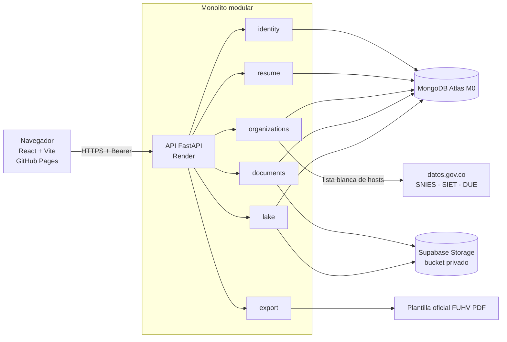
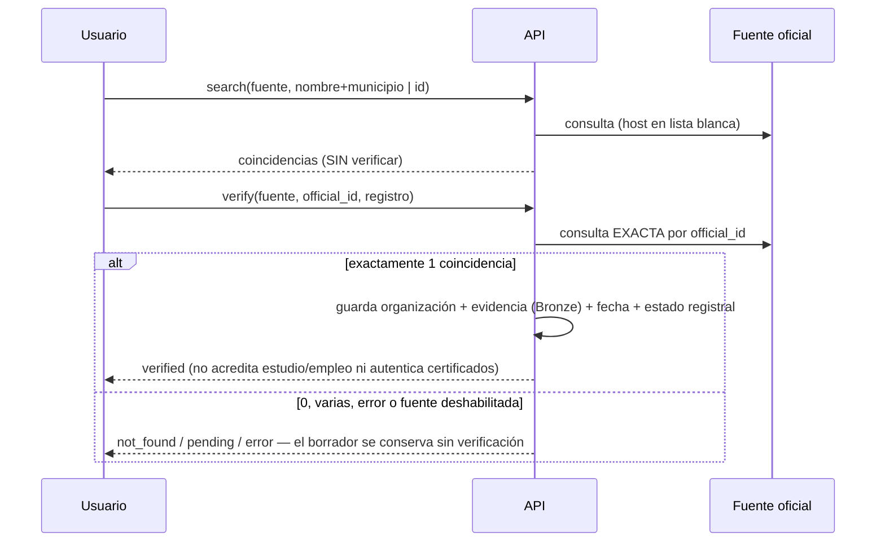
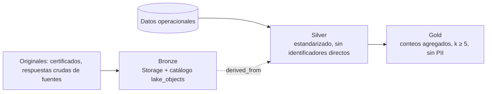

# Arquitectura

Monolito modular en el backend; el navegador solo habla con la API.

Reglas: los módulos se hablan por `service.py` (no por colecciones ajenas, salvo lectura de catálogo); el navegador nunca recibe credenciales de Mongo ni de Storage.

## Estados (no mezclar)
| Campo | Valores | Significado |
|---|---|---|
| `organization_status` | pending · verified · not_found · error | Solo `verified` si el backend confirmó el **identificador oficial** exacto |
| `record_status` | draft · declared · supported | borrador · antecedente declarado por el usuario · con ≥1 soporte `ready` |
| `document_status` | uploading · ready · rejected · delete_pending | ciclo de vida del soporte |
| `authenticity` | not_validated | único valor: el sistema no autentica certificados |

## Verificación de entidades

## Carga de soportes (consistencia)
validar → idempotencia/duplicado → metadatos `uploading` → escribir en Storage → comprobar tamaño → catalogar Bronze → `ready`. Fallo antes de `ready` ⇒ `rejected`, objeto limpiado, reintentable. Borrado: `delete_pending` → Storage → tombstone en catálogo → metadatos; si Storage falla queda `delete_pending` (reintentable). Retención de temporales: 30 días (`cleanup_stale`).

## Concurrencia
`revision` entera: `PUT` con revisión distinta ⇒ **409** con la versión del servidor; el frontend ofrece cargar la del servidor o conservar la propia.

## Tiempo total (sección 4)
Intervalos semiabiertos; el día de retiro cuenta (+1 día); unión de traslapes por categoría y global; 365 días = 1 año, 30 = 1 mes. **Estimación académica**, no certificación de tiempo de servicio.

## Exportación
Texto superpuesto (reportlab) sobre la plantilla oficial (pypdf). No se completan: entidad receptora, declaración SI/NO, ciudad y fecha, firma, observaciones RR.HH. Límites físicos de la plantilla: 5 filas de educación superior y 2 de idiomas (se advierte; no se ocultan); experiencias: se repite la página 2 cada 4.

## Data lake

Duplicados: un mismo contenido por usuario y registro (índice único parcial); evidencia de fuentes deduplicada por (propietario, sha256). Linaje: `lake_objects.derived_from`.
